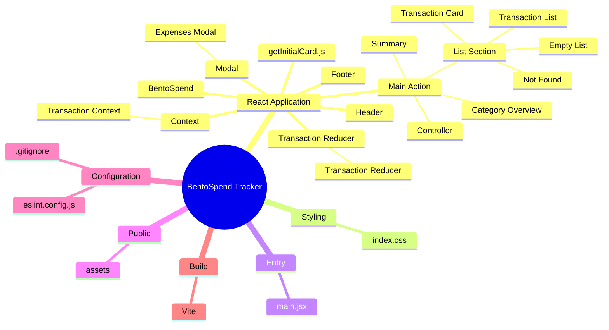
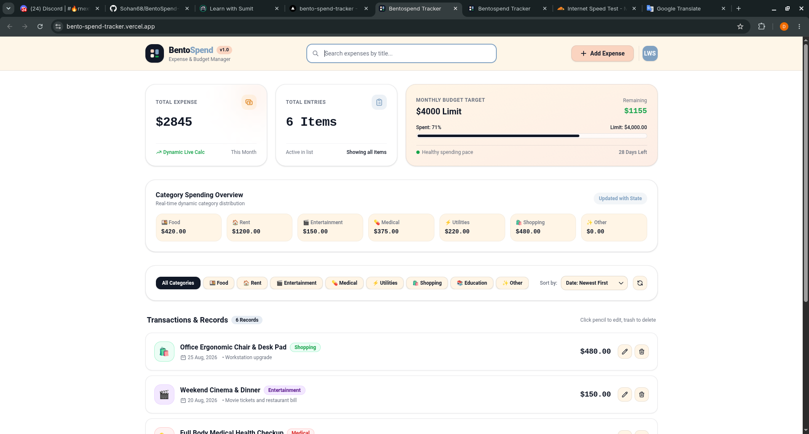
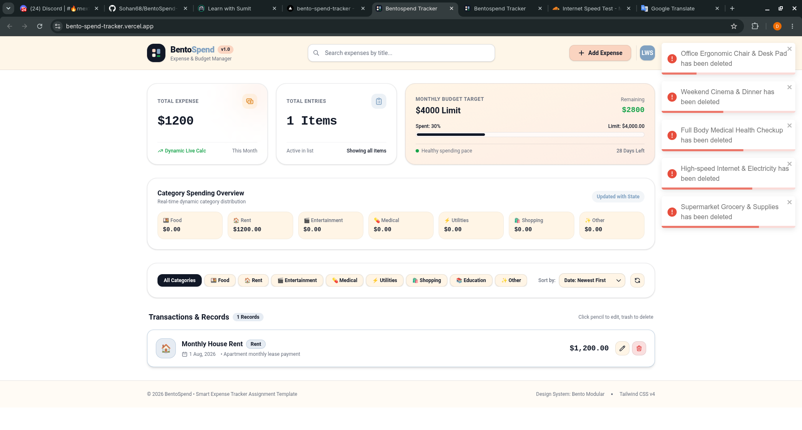
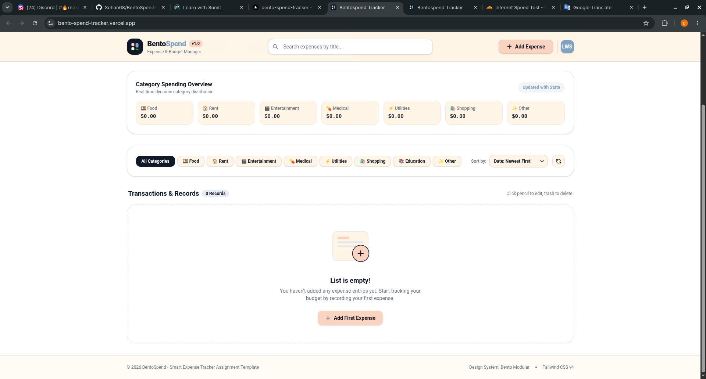
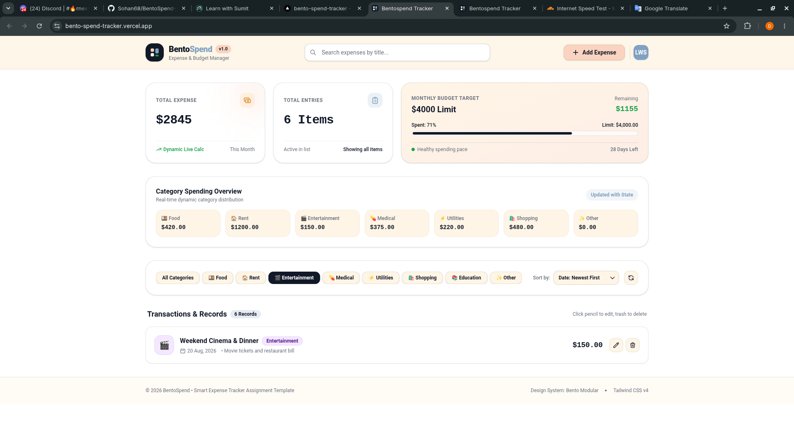
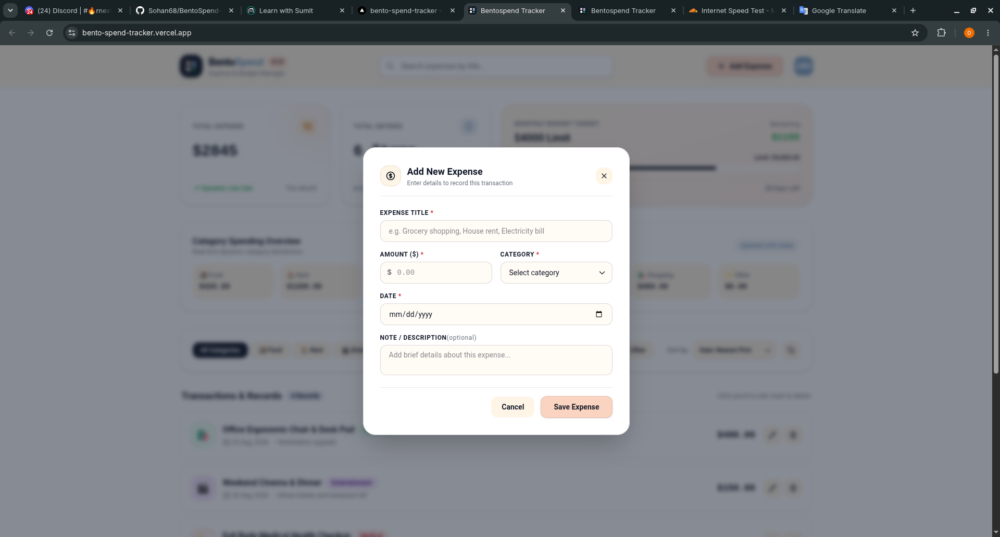
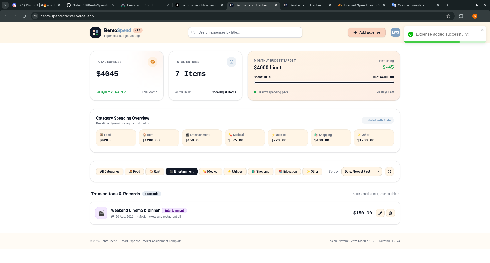

Download: [BentoSpend_Tracker_README.md](https://github.com/user-attachments/files/33064171/BentoSpend_Tracker_README.md)

# BentoSpend Tracker

[](https://react.dev/)
[](https://vite.dev/)
[](https://developer.mozilla.org/en-US/docs/Web/JavaScript)
[](https://eslint.org/)
[](https://vercel.com/)

> A modern React + Vite expense tracking interface built with reusable components and a clean, organized frontend structure.

---

## 📌 Table of Contents

- [Overview](#-overview)
- [Mind Map](#-mind-map)
- [Folder Structure](#-folder-structure)
- [Preview / Demo](#-preview--demo)
- [Features](#-features)
- [Tech Stack](#-tech-stack)
- [Installation](#-installation)
- [Usage](#-usage)
- [Production Build](#-production-build)
- [Deployment](#-deployment)
- [Contributing](#-contributing)
- [License](#-license)
- [Credits / References](#-credits--references)

---

## 📝 Overview

**BentoSpend Tracker** is a React-based frontend project designed around an organized expense and transaction tracking interface.

The application is divided into reusable React components, with dedicated sections for transaction lists, category overview, summary information, transaction controls, expense modal interactions, and transaction state management.

The project uses **Vite** for fast development and optimized production builds.

### Project Goals

- Build a clean and organized expense tracking interface.
- Keep transaction-related UI separated into reusable components.
- Manage transaction data using Context and Reducer patterns.
- Organize project files into logical folders.
- Maintain a responsive and user-friendly layout.
- Keep the codebase easy to extend and maintain.

---

## 🧠 Mind Map



---

## 📁 Folder Structure

The following structure is based on the BentoSpend Tracker project structure shown in the development environment:

```text
BentoSpend Tracker/
│
├── node_modules/
│
├── public/
│
├── src/
│   │
│   ├── assets/
│   │
│   ├── Contex/
│   │   └── TransactionContex...jsx
│   │
│   ├── MainAction/
│   │   │
│   │   ├── ListSection/
│   │   │   ├── EmptyList.jsx
│   │   │   ├── NotFound.jsx
│   │   │   ├── TransactionC...jsx
│   │   │   └── TransactionLis...jsx
│   │   │
│   │   ├── CategoryOver...jsx
│   │   ├── Controller.jsx
│   │   ├── MainAction.jsx
│   │   └── Summary.jsx
│   │
│   ├── Modal/
│   │   └── ExpensessMo...jsx
│   │
│   ├── TransactionReducer/
│   │   └── TransactionReduc...js
│   │
│   ├── BentoSpend.jsx
│   ├── Footer.jsx
│   ├── getInitialCard.js
│   ├── Header.jsx
│   ├── index.css
│   └── main.jsx
│
├── .gitignore
├── eslint.config.js
├── index.html
├── modal.html
├── package-lock.json
├── package.json
├── README.md
└── vite.config.js
```

> **Note:** Some filenames inside `Contex`, `TransactionCard`, `TransactionList`, `CategoryOverview`, `ExpensesModal`, and `TransactionReducer` are truncated in the provided project-tree screenshot. Replace the `...` entries with their exact filenames from your local project if needed.

### Main Directory Responsibilities

| Directory / File      | Purpose                                     |
| --------------------- | ------------------------------------------- |
| `public/`             | Static public assets                        |
| `src/`                | Main React source code                      |
| `src/assets/`         | Project assets                              |
| `Contex/`             | Shared transaction context                  |
| `MainAction/`         | Main transaction-related interface          |
| `ListSection/`        | Transaction list and empty/not-found states |
| `Modal/`              | Expense modal interface                     |
| `TransactionReducer/` | Transaction state reducer                   |
| `BentoSpend.jsx`      | Main BentoSpend application component       |
| `Header.jsx`          | Application header                          |
| `Footer.jsx`          | Application footer                          |
| `getInitialCard.js`   | Initial card/data-related helper            |
| `main.jsx`            | React application entry point               |
| `index.css`           | Global styling                              |
| `eslint.config.js`    | ESLint configuration                        |
| `vite.config.js`      | Vite configuration                          |

---

## 🖼️ Preview / Demo








### Live Demo

deployed Vercel URL here:

**Live Demo:** `https://bento-spend-tracker.vercel.app/`

### Project Screenshot

Add a project screenshot to:

```text
docs/screenshots/bentospend-tracker.png
```

Then display it here:

```md

```

> If the screenshot file does not exist yet, add it to the path above or remove the image reference.

---

## ✨ Features

- 💰 Expense and transaction tracking interface
- ➕ Expense creation through a dedicated modal
- 📋 Transaction list
- 🧾 Individual transaction cards
- 📊 Spending summary
- 📈 Category overview
- 🎛️ Transaction controller
- 🚫 Empty list state
- 🔎 Not-found state
- 🧠 Transaction Context for shared state
- 🔄 Reducer-based transaction state management
- 🧩 Reusable React components
- 🎨 Organized frontend structure
- 📱 Responsive-friendly interface
- ⚡ Fast development with Vite
- 🔍 ESLint configuration
- 🚀 Ready for Vercel deployment

---

## 🛠️ Tech Stack

| Technology           | Purpose                           |
| -------------------- | --------------------------------- |
| **React**            | UI development                    |
| **Vite**             | Development server and build tool |
| **JavaScript / JSX** | Application logic and components  |
| **CSS**              | Styling                           |
| **React Context**    | Shared transaction state          |
| **Reducer Pattern**  | Transaction state management      |
| **ESLint**           | Code quality and linting          |
| **Git**              | Version control                   |
| **GitHub**           | Source-code hosting               |
| **Vercel**           | Deployment                        |

---

## 📦 Installation

### Prerequisites

Make sure you have the following installed:

- **Node.js**
- **npm**
- **Git**

You can verify your installation with:

```bash
node -v
npm -v
git --version
```

### 1. Clone the Repository

```bash
git clone YOUR_GITHUB_REPOSITORY_URL
```

### 2. Enter the Project Directory

```bash
cd "BentoSpend Tracker"
```

### 3. Install Dependencies

```bash
npm install
```

### 4. Start the Development Server

```bash
npm run dev
```

Vite will provide a local development URL in the terminal, usually:

```text
http://localhost:5173
```

Open that URL in your browser.

---

## ▶️ Usage

After starting the development server:

1. Open the BentoSpend Tracker interface.
2. Review the spending summary.
3. View the transaction list.
4. Use the transaction controller.
5. Add expenses through the expense modal.
6. Review transaction cards.
7. Check the category overview.
8. Review empty or not-found states when applicable.

> The exact behavior depends on the functionality implemented in the current version of the project.

---

## 🏗️ Production Build

Create an optimized production build with:

```bash
npm run build
```

Vite will generate the production-ready files inside:

```text
dist/
```

### Preview the Production Build

```bash
npm run preview
```

---

## 🚀 Deployment

This project is suitable for deployment on **Vercel**.

### Vercel Settings

| Setting               | Value           |
| --------------------- | --------------- |
| Framework Preset      | Vite            |
| Build Command         | `npm run build` |
| Output Directory      | `dist`          |
| Install Command       | `npm install`   |
| Environment Variables | None            |

### Deploy Steps

1. Push the project to GitHub.
2. Sign in to Vercel.
3. Select **Add New → Project**.
4. Import the GitHub repository.
5. Confirm the Vite framework preset.
6. Confirm the build command:

   ```bash
   npm run build
   ```

7. Confirm the output directory:

   ```text
   dist
   ```

8. Click **Deploy**.

Vercel will automatically build and deploy the application.

---

## 🔧 Available Scripts

| Command           | Description                  |
| ----------------- | ---------------------------- |
| `npm install`     | Install dependencies         |
| `npm run dev`     | Start the development server |
| `npm run build`   | Create the production build  |
| `npm run preview` | Preview the production build |
| `npm run lint`    | Run ESLint                   |

---

## 🌱 Environment Variables

This project currently does not require environment variables.

If environment variables are introduced in the future, create a local `.env` file and keep sensitive values out of version control.

Example:

```env
VITE_API_URL=your_api_url
```

> Never commit API keys, passwords, access tokens, or other private credentials to GitHub.

---

## 🤝 Contributing

Contributions and improvements are welcome.

### Contribution Workflow

1. Fork the repository.
2. Clone your fork.
3. Create a new feature branch:

```bash
git checkout -b feature/your-feature-name
```

4. Make your changes.
5. Test the application locally:

```bash
npm run dev
```

6. Run the linter:

```bash
npm run lint
```

7. Test the production build:

```bash
npm run build
```

8. Commit your changes:

```bash
git add .
git commit -m "Add: your feature description"
```

9. Push your branch:

```bash
git push origin feature/your-feature-name
```

10. Open a Pull Request.

### Commit Message Examples

```text
Add: transaction card component
Fix: transaction list issue
Update: summary section
Refactor: transaction state management
Style: improve responsive layout
Docs: update README
```

---

## 📄 License

This project is currently intended for **personal, educational, and portfolio purposes**.

If you plan to distribute, modify, or use this project commercially, add an appropriate open-source license.

> No formal open-source license has been specified for this repository unless a `LICENSE` file is added.

---

## 👨‍💻 Credits / References

### Development

- **React** — UI library  
  https://react.dev/

- **Vite** — Frontend build tool  
  https://vite.dev/

- **MDN Web Docs** — Web development references  
  https://developer.mozilla.org/

- **ESLint** — JavaScript linting  
  https://eslint.org/

- **GitHub** — Version control and repository hosting  
  https://github.com/

- **Vercel** — Deployment platform  
  https://vercel.com/

### Project Credit

**Project:** BentoSpend Tracker  
**Type:** React + Vite Frontend Project  
**Purpose:** Expense tracking and transaction management interface

---

## 📌 Project Status

**Status:** Active Development 🚧

The project structure and UI may continue to evolve as new components, features, and improvements are added.

---

⭐ Support: https://www.linkedin.com/in/sohantalukder68/

👨‍💻 Author:
Dev Sohan
GitHub: https://github.com/Sohan68/
If you find this project useful, consider giving the repository a ⭐ on GitHub.

---

**Made with ❤️ using React + Vite**
